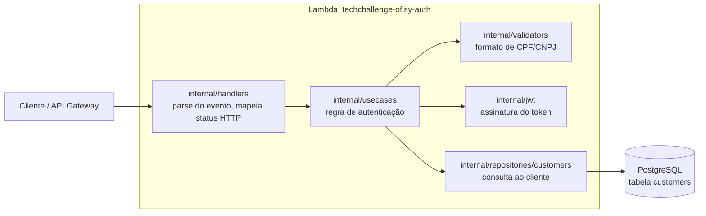
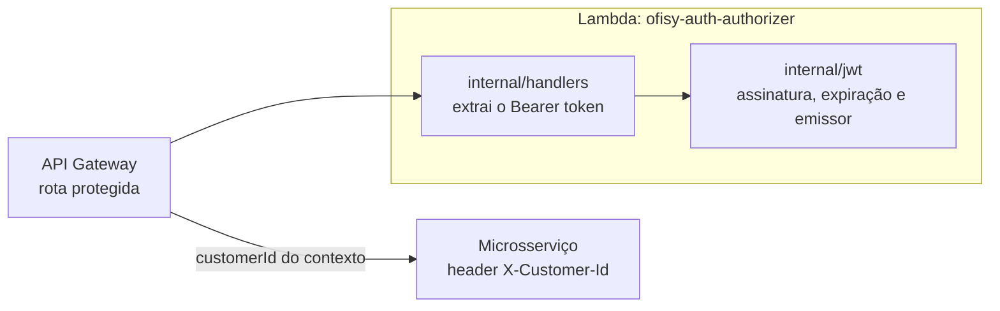

# Tech Challenge Ofisy Auth

Duas Lambdas em Go: uma autentica clientes por CPF/CNPJ e devolve um token JWT, e a outra é o Lambda Authorizer do API Gateway, que valida esse token nas rotas do cliente.

## Sobre o serviço

Este serviço implementa autenticação para os endpoints acessados pelos clientes, que anteriormente eram públicos no monolito core (techchallenge-ofisy). Não há autenticação por senha: o cliente se autentica informando CPF ou CNPJ, a Lambda `ofisy-auth` valida no Postgres do core a existência e o status ativo do registro, e retorna um JWT assinado com HS256.

Nas rotas protegidas do API Gateway (status da OS, aprovação e reprovação do orçamento e notificações da OS), a Lambda `ofisy-auth-authorizer` valida o token e repassa o id do cliente para o API Gateway, que o envia ao microsserviço no header `X-Customer-Id`. Os microsserviços não validam o token do cliente: confiam nesse header.

## Stack

- **Go 1.26** - linguagem
- **AWS Lambda** (`aws-lambda-go`) - empacotado como `provided.al2023`/arm64
- **PostgreSQL** (`pgx` + `sqlx`) - persistência dos clientes
- **golang-jwt/jwt** - geração e assinatura do token (HS256)
- **Docker** - build da imagem da Lambda e Postgres local via Compose

## Estrutura de diretorios

```
techchallenge-ofisy-auth/
├── cmd/
│   ├── lambda/
│   │   └── main.go              # entry point da Lambda de emissão do token (ofisy-auth)
│   └── authorizer/
│       └── main.go              # entry point do Lambda Authorizer (ofisy-auth-authorizer)
├── internal/
│   ├── config/                  # carga e validação de variáveis de ambiente
│   ├── database/                # conexão com o Postgres
│   ├── handlers/                # adapta os eventos do API Gateway (autenticação e authorizer)
│   ├── jwt/                     # geração e validação do token
│   ├── models/                  # structs de request/response e domínio
│   ├── repositories/customers/  # consulta ao cliente por cpf/cnpj
│   ├── usecases/                # regra de autenticação (Authenticate)
│   └── validators/              # validação de CPF/CNPJ
├── docs/
│   └── TESTING.md               # testes unitários, de integração e análise estática
├── compose.yaml                 # LocalStack (Lambda) + Postgres local
├── compose.sonar.yaml           # SonarQube local para análise estática
├── sonar-project.properties     # configuração do scanner (fontes, testes, cobertura)
├── Dockerfile                   # build da imagem da Lambda de emissão do token
├── Dockerfile.authorizer        # build da imagem do Lambda Authorizer
├── Makefile
└── go.mod
```

## Arquitetura





## Contrato da API

### `POST /auth/customers`

Recebe o CPF ou CNPJ do cliente e devolve um JWT.

**Request Body:**

```json
{
  "cpfCnpj": "52998224725"
}
```

| Campo     | Tipo   | Obrigatório | Descrição                                                 |
| --------- | ------ | ----------- | --------------------------------------------------------- |
| `cpfCnpj` | string | Sim         | CPF (11 dígitos) ou CNPJ (14 dígitos), com ou sem máscara |

**Respostas:**

| Código | Descrição                                            | Body                                              |
| ------ | ---------------------------------------------------- | ------------------------------------------------- |
| `200`  | Autenticado com sucesso                              | `{ "token": "<JWT>" }`                            |
| `400`  | Body da requisição não é um JSON válido              | `{ "error": "Corpo da requisição inválido" }`     |
| `401`  | CPF/CNPJ inválido, cliente não encontrado ou inativo | `{ "error": "Credenciais de cliente inválidas" }` |
| `500`  | Falha inesperada (banco, geração do token, etc.)     | `{ "error": "Erro interno do servidor" }`         |

O 401 nunca diferencia a causa. Formato inválido, cliente inexistente ou cliente inativo colapsam na mesma mensagem, de propósito, para não dar pista de quais CPFs/CNPJs existem na base.

Token: JWT assinado com HS256, `sub` = ID do cliente, `iss` = `techchallenge-ofisy-auth`, `exp` conforme `JWT_EXPIRATION`. Use no header `Authorization: Bearer <token>` dos demais serviços.

Exemplo com cURL, contra o endpoint publicado no API Gateway:

```bash
curl -X POST https://<api-gateway-url>/auth/customers \
  -H "Content-Type: application/json" \
  -d '{"cpfCnpj": "52998224725"}'
```

### Lambda Authorizer

O authorizer é do tipo REQUEST, com payload format version 2.0 e resposta simples. Ele lê o header `Authorization: Bearer <token>` e confere a assinatura HS256 com o mesmo `JWT_SECRET`, a expiração e o emissor (`iss` = `techchallenge-ofisy-auth`). Com o token válido, responde `isAuthorized: true` com o `customerId` (o `sub` do token) no contexto. O API Gateway sobrescreve o header `X-Customer-Id` com esse valor antes de encaminhar a requisição, então um header forjado pelo cliente é descartado.

Qualquer falha (header ausente, token malformado, expirado, de outro emissor ou com outro algoritmo) vira `isAuthorized: false`, e o API Gateway responde `403`. O motivo fica só nos logs. O authorizer não acessa o banco e roda fora da VPC.

O token de funcionário emitido pelo core tem outro emissor e é recusado pelo authorizer. As rotas de funcionário não passam por ele: cada microsserviço valida o JWT de funcionário.

## Variáveis de ambiente

Veja `.env.example`:

```bash
# Banco de dados
POSTGRES_HOST=localhost
POSTGRES_PORT=5432
POSTGRES_DB=ofisydb
POSTGRES_USER=postgres
POSTGRES_PASSWORD=postgres
POSTGRES_SSL_MODE=disable

# JWT
JWT_SECRET=changeme
JWT_EXPIRATION=1h
```

`POSTGRES_USER`, `POSTGRES_PASSWORD`, `POSTGRES_DB` e `JWT_SECRET` são obrigatórios: a aplicação recusa subir sem eles. `JWT_EXPIRATION` aceita qualquer duração válida de `time.ParseDuration` (`1h`, `24h`, `30m`) e cai para `1h` se estiver ausente ou for inválida.

O authorizer só usa o `JWT_SECRET`, que precisa ser o mesmo da Lambda de emissão do token.

## Rodando o projeto

`make` sem argumentos lista todos os alvos disponíveis, agrupados por finalidade. Os principais:

```bash
make dev-up     # sobe LocalStack (Lambda) + Postgres local (compose.yaml)
make vet        # go vet
make build      # compila o binário bootstrap (linux/arm64)
make build-authorizer  # compila o binário bootstrap-authorizer (linux/arm64)
```

`make run` (`go run ./cmd/lambda`) sobe a aplicação e conecta no Postgres, mas `lambda.Start` exige as variáveis de ambiente da Runtime API da AWS ou a ponte RPC do SAM CLI — não dá pra mandar requisição HTTP direto contra esse processo.

Para validar a Lambda de ponta a ponta sem subir o ambiente AWS real, use o LocalStack:

```bash
make dev-up                    # sobe LocalStack + Postgres
make lambda-deploy             # builda, empacota e registra a função no LocalStack
make lambda-invoke             # invoca a função com um payload de teste
make lambda-deploy-authorizer  # builda, empacota e registra o authorizer no LocalStack
make lambda-invoke-authorizer  # invoca o authorizer com um token de exemplo
```

`make lambda-deploy` cria a função `ofisy-auth` (runtime `provided.al2023`/arm64) apontando para o Postgres do compose (hostname `postgres`, mesma rede Docker). O `scripts/seed.sql` popula a tabela `customers` com registros de teste; rode-o manualmente se precisar recriá-la:

```bash
docker exec -i postgres-auth-local-db psql -U "$POSTGRES_USER" -d "$POSTGRES_DB" < scripts/seed.sql
```

`make dev-down` derruba o LocalStack e o Postgres local quando terminar.

## Testes e análise estática

```bash
make test              # testes unitários, rápido e sem Docker
make test-integration  # camada de repositório com Testcontainers (exige Docker)
make cover-check       # tudo junto, com o gate de cobertura de 70%
make sonar             # análise estática no SonarQube local
```

Consulte [`docs/TESTING.md`](docs/TESTING.md) para os detalhes: escopo de cada suíte, cenários cobertos na camada de repositório, gate de cobertura e configuração do SonarQube.

## Deploy (CD)

O workflow `cd.yml` publica as imagens `ofisy-auth` e `ofisy-auth-authorizer` no ECR (tag = SHA curto do commit) e, se as funções já existirem, atualiza o código de cada Lambda. Ele só roda se a CI tiver passado para o commit. É a etapa 3 da [ordem de execução](https://github.com/15SOAT-FIAP/techchallenge-ofisy-eks-infra#ordem-de-execução-entre-os-repositórios) descrita no `techchallenge-ofisy-eks-infra`.

Além do `workflow_dispatch`, ele aceita `workflow_call` e é chamado pelo `up.yml` do [ofisy-platform](https://github.com/15SOAT-FIAP/ofisy-platform), com os secrets vindo por `secrets: inherit`. Quando chamado de outro repositório, o checkout usa a branch padrão (`master`) deste repositório. As tags publicadas saem como outputs, para a etapa 5 (`deploy-auth-lambda.yml` do eks-infra) criar as funções:

| Output | Imagem |
| :--- | :--- |
| `image_tag` | `ofisy-auth` |
| `authorizer_image_tag` | `ofisy-auth-authorizer` |

Este repositório não tem workflow de destroy: as funções são destruídas pelo `infra-auth/` e os ECRs pelo `infra/`, ambos no eks-infra.
